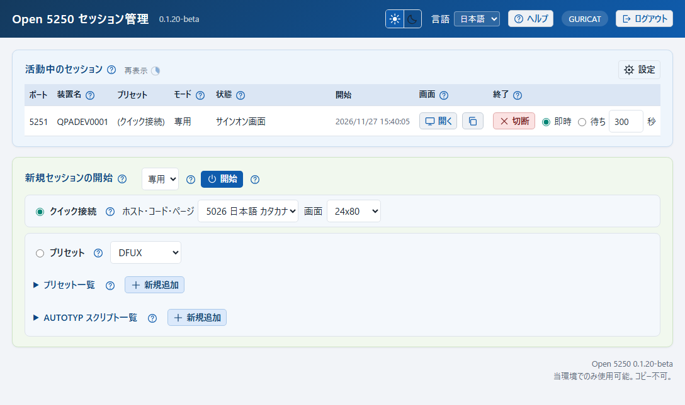
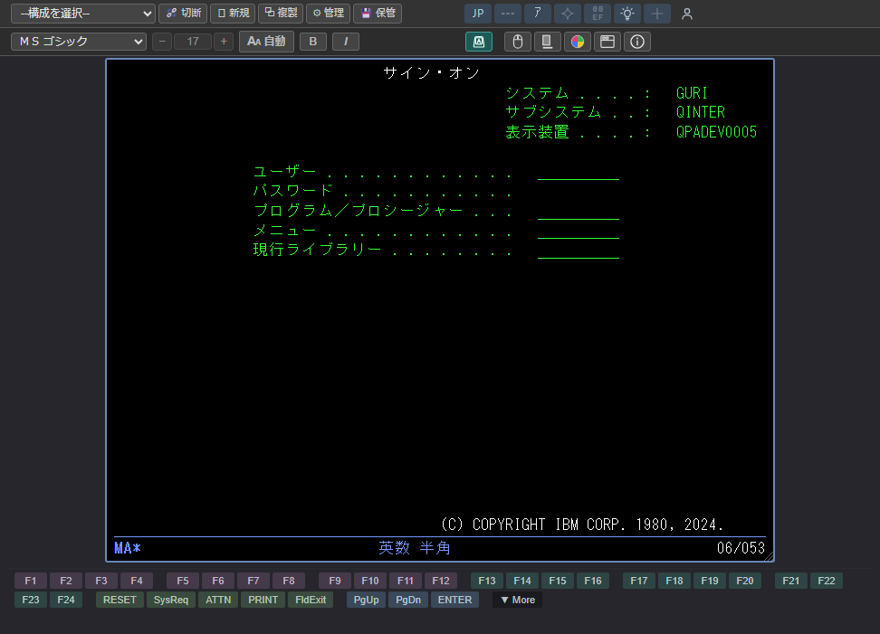
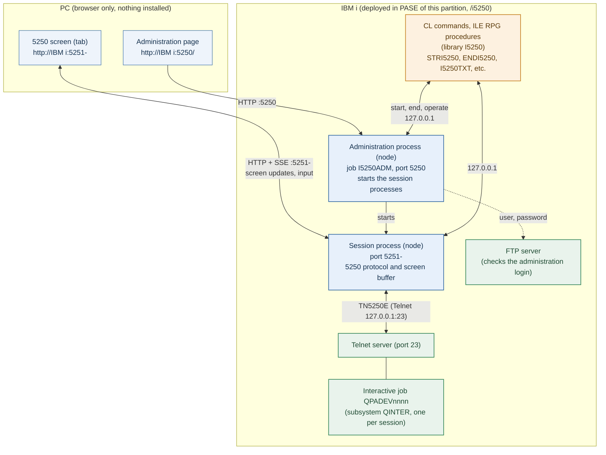
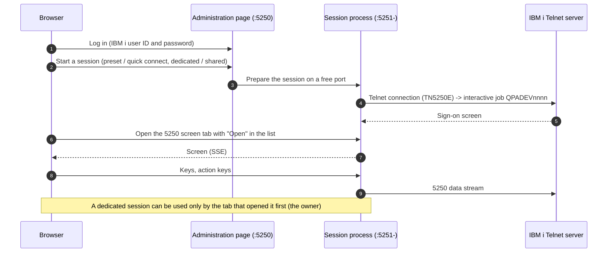

# Open 5250

> 日本語版は [`README_ja.md`](README_ja.md) を参照してください。 (Japanese version: see [`README_ja.md`](README_ja.md).)

Open 5250 is a browser-based 5250 terminal emulator that runs on IBM i itself (PASE). Nothing needs to be installed on the PC: users open a web browser and use the 5250 screen.
For details, see the manual `docs/Open5250-Guide.pdf` (Open 5250 User and Administration Guide: operating procedures, CL command syntax, and the ILE RPG procedure specifications; Japanese only).
`docs/open5250-guide.html`, opened from the help in the administration page and the 5250 screen, is a summary of it.
For operating the 5250 screen (keys, toolbar, copy and paste, AUTOTYP, and so on), see `docs/IBM5250-MCP-User-Guide-EN.pdf` (IBM 5250 MCP User Guide). Behavior and restrictions that differ from IBM 5250 MCP are listed in section 4.7 of the manual.

## How it works

| Administration page (start/end sessions, presets) | 5250 screen (a browser tab) |
|---|---|
|  |  |

*(The screenshots are from a Japanese system; the UI also has English.)*

### What runs where



- **The PC only needs a browser**; nothing is installed. Open 5250 runs in PASE on IBM i.
- The 5250 traffic stays inside this partition (127.0.0.1:23). A preset can also point to another IBM i.
- **Traffic to the browser is not encrypted (HTTP).** Use it on an internal LAN.

### From start to use of a session



## Read first

- **This is a time-limited beta release. It works until 2027-01-31.**
  From 2027-02-01, startup and connection are automatically refused. Obtain a newer build to continue.
  When the license has expired, it shows "This license has expired" and ends. The message is recorded in `log/admin.log` for the administration page (`start-admin.sh` also shows it on the terminal) and in `log/session-<port>.log` for a session started from the administration page. The browser only shows that it could not start or connect, so check these logs for the reason.
- **Node.js v22 is required.** It uses `/QOpenSys/pkgs/lib/nodejs22/bin/node` (`yum install nodejs22`). The default `node` may be a different version (the scripts call it by full path).
- **Communication is not encrypted (HTTP).** The login password of the administration page and the 5250 screen contents are sent in plain text. Use it on an internal LAN.
- **5250 session ports have no authentication.** Anyone who knows the port number can operate that session (the same idea as HMC shared sessions). If you do not want others to touch it, start it as "dedicated".
- The connection target is specified by a preset (this partition 127.0.0.1:23 or another IBM i). Quick connect connects to this partition. Open 5250 itself runs only on the partition where it is deployed.
- **Deploy only one per partition.** The administration page port is fixed at 5250. Do not deploy a second one on the same partition and start its administration page.

## Deployment

The installation directory is **`/i5250`** (hereafter "install dir"; the same name as the ILE API library `I5250`). Detailed steps are in sections 2.1 and 2.2 of the manual.

1. **Transfer**: extract the zip on a PC and transfer the contents of the `open5250-ibmi` folder to `/i5250` in the IBM i IFS. **With FTP, always use binary mode** (a text transfer breaks the save file `I5250.SAVF` and the main program `ibm5250.jsc`).
2. **config.json (first time only)**: copy `config.example.json` to `config.json`. When updating, keep the existing `config.json`, `presets` and `scripts`.
3. **Permissions**: run `chmod 755 *.sh` in the install dir.
4. **Restore library I5250** (the CL commands STRI5250 and ENDI5250 and the ILE API; IBM i V7R4M0 or later): as a user such as QSECOFR, run the following on a command line.

```
CRTSAVF FILE(QGPL/I5250)
CPYFRMSTMF FROMSTMF('/i5250/I5250.SAVF') TOMBR('/QSYS.LIB/QGPL.LIB/I5250.FILE') MBROPT(*REPLACE) CVTDTA(*NONE)
RSTLIB SAVLIB(I5250) DEV(*SAVF) SAVF(QGPL/I5250)
DLTF FILE(QGPL/I5250)
```

- When updating, first end the administration page with `ENDI5250` and delete the old library with `DLTLIB LIB(I5250)`, then restore.
- If the install dir is not `/i5250`, run `CHGDTAARA DTAARA(I5250/I5250DIR (1 256)) VALUE('<install dir>')` after restoring (STRI5250 and ENDI5250 read the install dir from this data area).

## Usage

### Commands

| Task | Command (run in the install dir) |
|---|---|
| Start the administration page (CL command) | `I5250/STRI5250` (runs in batch job I5250ADM). `RESTART(*YES)` ends everything and then starts again |
| End everything (CL command) | `I5250/ENDI5250` (ends all sessions and the administration page) |
| Start the administration page (shell) | `./start-admin.sh` → open `http://<IBM i>:5250/` in a browser |
| End the administration page (shell) | `./stop-admin.sh` (running sessions do not stop) |
| Start a session | `./start-session.sh <preset> [shared\|dedicated]` → open the displayed port in a browser |
| End a session | `./stop-session.sh <port> [cntrld [seconds] \| immed]` |
| List sessions | `./list-sessions.sh` |

### Administration page

**Sign in** with an IBM i user ID and password.

- They are verified by the FTP server of this partition. **The FTP server must be running.**
- Failed attempts count toward QMAXSIGN, like sign-on failures.

**What you can do** (the ? next to each item shows a description)

| Item | Description |
|---|---|
| Start / end sessions | Start from a preset, or with quick connect (choose only a code page and screen size, no preset) |
| Presets | Create, edit and delete connection settings. One file per preset (`presets/<name>.i5250`) |
| AUTOTYP scripts | Create, edit and delete ("Edit" and "Delete" on each row of the lists) |
| Settings (gear) | Maximum number of sessions, inactivity timeout, dedicated release time, and so on |

**Quick connect defaults**

| Item | Default |
|---|---|
| Code page | 930 (5026 Japanese Katakana, the ACS default) when the primary language is Japanese (2962 or 2930); 037 otherwise |
| Screen size | 24x80 |
| Shared / dedicated | Dedicated |

### Sessions

- **Ports**: free numbers are used in order from 5251. The maximum is set on the administration page (default 10 = 5251 to 5260).
- **Closing the browser does not end the session.** End it from the administration page or with `stop-session.sh`.

**How sessions end**

| State / option | What happens |
|---|---|
| On the sign-on screen | Ends immediately |
| `cntrld` (wait, default) | Waits for the sign-on screen to return (default 300 seconds, 0 to 99999 seconds). After the time limit it moves to `immed` |
| `immed` (immediate) | Signs off with SysReq → 90 and then disconnects |

The default wait time is `ibmi.stop_timeout_default` in `config.json`. It is not an inactivity timeout.

### Shared and dedicated

| Mode | Who can use it |
|---|---|
| Shared | Anyone can view and type |
| Dedicated | Only the tab that opened the screen first (the owner) |

**In dedicated mode the owner is a tab.** Opening the screen in any of these is refused:

- another tab of the same browser, or a tab made with "Duplicate tab"
- another browser on the same PC
- a browser on another client (another PC)

**A refused tab** shows a warning and is closed. However, browsers restrict which tabs a script may close, so only tabs opened with "Open" in the list on the administration page, and their duplicates, can be closed. Tabs opened by entering the URL in the address bar (and their duplicates) or with "Open in new tab" from the right-click menu remain as a blank screen (no input is possible; close them by hand).

**Until another tab can open it**

| Trigger | Time |
|---|---|
| The owner tab was closed | The "Dedicated release time" (administration page settings, default 5 minutes; 0 = about 5 seconds) |
| The owner tab stopped responding (the PC sleeps, the line is cut, the browser puts background tabs to sleep, and so on) | About 1 minute after it stopped responding + the "Dedicated release time" |

### STRI5250 / ENDI5250 (CL commands)

- Like the ILE API, they are in library I5250, restored from the save file `I5250.SAVF` in the package (IBM i V7R4M0 or later; see section 2.2 of the manual).
- **Only users with user class *SECOFR can run them** (the commands are `*PUBLIC *EXCLUDE`).
- Each parameter is described in the F1 help. The progress is recorded in `log/i5250cmd.log` in the install dir.

| Parameter | Values (default in bold) |
|---|---|
| `OPTION` | **`*CNTRLD`** / `*IMMED` (same as ENDSBS) |
| `DELAY` | 1-99999 / **`*NOLIMIT`** (same as ENDSBS) |
| `JOBQ` (STRI5250) | **`QSYS/QSYSNOMAX`** (subsystem QSYSWRK) |

- `*CNTRLD` waits DELAY seconds for the sign-on screen to return or the session to disconnect, then moves to `*IMMED` (signs off with SysReq → 90 and then disconnects). Processes that do not respond are forcibly ended.
- Interactive jobs of 5250 sessions run in QINTER as before. Ending only the administration page job I5250ADM with ENDJOB does not stop the 5250 sessions (they are separate jobs). Use ENDI5250 to stop everything.

### Language and display settings

- **Language**: when the primary language of the IBM i is 2962 or 2930, the default display language of the 5250 screen is Japanese, and the initial code page when creating a preset on the administration page is cp1399. The display language can be switched with a button on the 5250 screen.
- **Where display settings are saved** (per PC of the user, like MCP 5250 saving them in the configuration file on that PC):

| Setting | Saved in |
|---|---|
| Toolbar toggles (input field highlighting, column separators, shift character display, blinking, crosshair ruler, cursor, toolbar hiding, display language) | The browser you use (a cookie). Whatever the port number, the same browser starts with the same settings. Another PC starts with the defaults |
| Font | For a session started from a preset, saved in that preset (`presets/<name>.i5250`). Quick connect uses the defaults each time |

- The font choices are a built-in list. If you choose a font that is not installed on the PC, a substitute monospaced font is used.

## Contents

`ibm5250.js` (launcher) / `ibm5250.jsc` (main program, V8 bytecode) / `I5250.SAVF` (save file of library I5250) / `node_modules/bytenode` / shell scripts / `config.example.json` / `VERSION` / `README.md`, `README_ja.md` / `CHANGELOG.md`, `CHANGELOG_ja.md` (Open 5250 changes) / `EULA.md` / `THIRD-PARTY-NOTICES.md` / `docs/open5250-guide.html` (help) / `docs/Open5250-Guide.pdf` (manual, Japanese) / `docs/images/` (images in this README)
