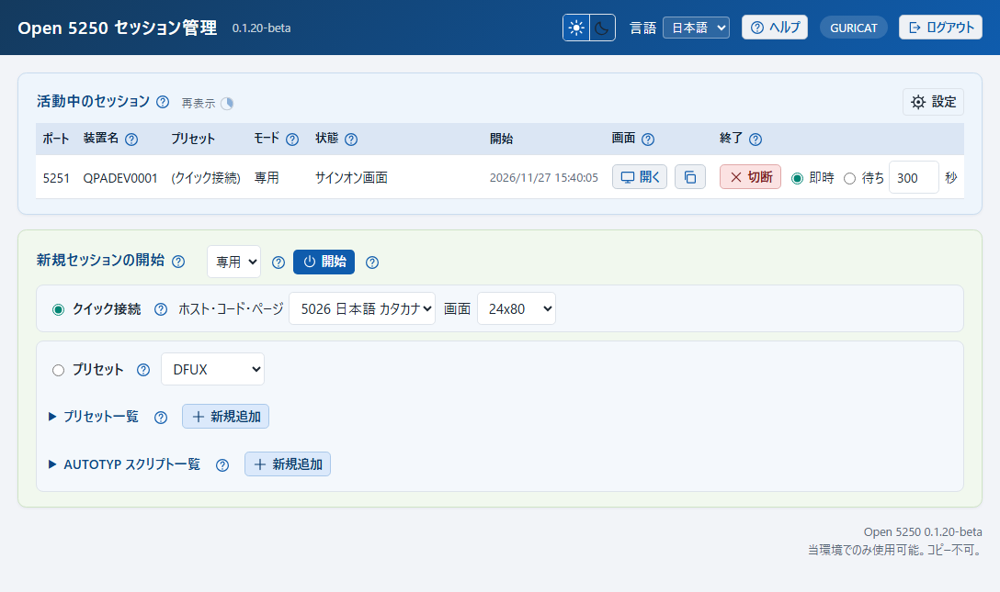
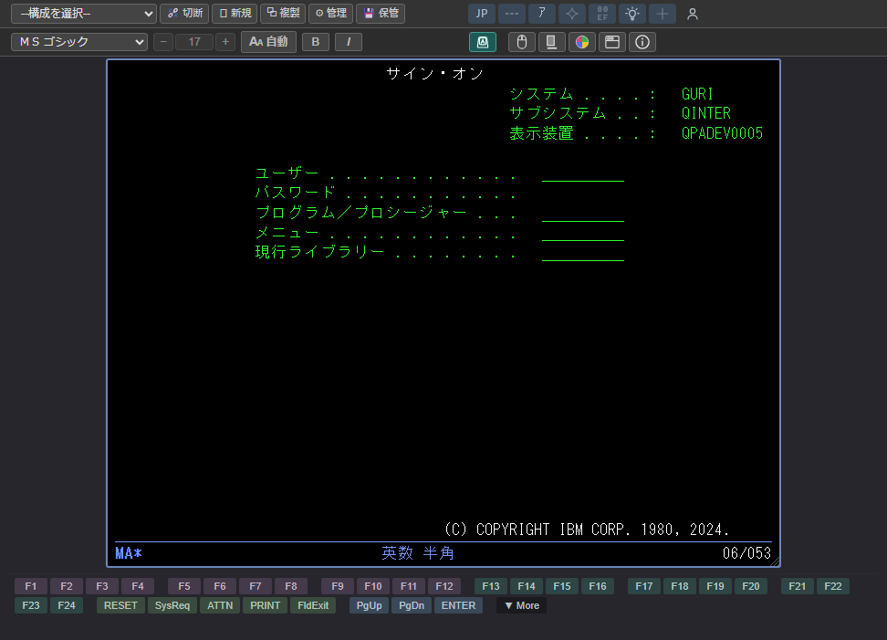
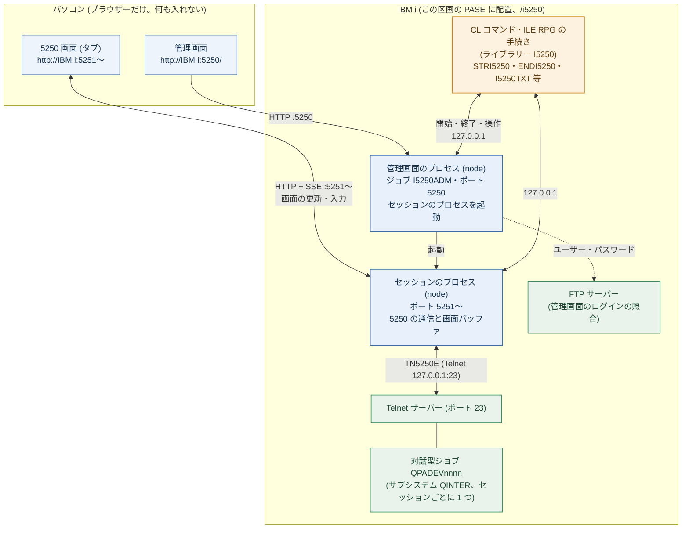
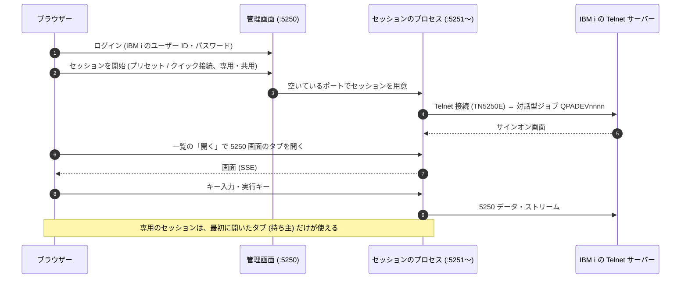

# Open 5250

> English version: see [`README.md`](README.md).

Open 5250 は、IBM i 自身 (PASE) の上で動き、ブラウザーで使う 5250 端末エミュレーターです。パソコンには何も入れる必要がなく、ブラウザーを開いて 5250 画面を使います。
使い方の詳細はマニュアル `docs/Open5250-Guide.pdf` (Open 5250 利用・管理ガイド。操作手順、CL コマンドの文法、ILE RPG の手続きの仕様) を参照してください。
管理画面と 5250 画面のヘルプで開く `docs/open5250-guide.html` は、その要約です。
5250 画面の操作 (キー・ツールバー・コピーと貼り付け・AUTOTYP 等) は `docs/IBM5250-MCP-User-Guide.pdf` (IBM 5250 MCP ユーザー・ガイド) を参照してください。IBM 5250 MCP と異なる動作・制約は、マニュアルの 4.7 節にまとめています。

## 構成と動き

| 管理画面 (セッションの開始・終了・プリセット) | 5250 画面 (ブラウザーのタブ) |
|---|---|
|  |  |

### どこで何が動くか



- **パソコンにはブラウザーがあればよく**、何も入れません。Open 5250 は IBM i の PASE の上で動きます。
- 5250 の通信はこの区画の中 (127.0.0.1:23) で閉じています。プリセットで別の IBM i を接続先にすることもできます。
- **ブラウザーとの通信は暗号化されていません (HTTP)**。社内 LAN で使ってください。

### セッションを使うまでの流れ



## 最初に読む注意点

- **本配布物は期間限定β公開版です。2027 年 1 月 31 日まで利用できます。**
  2027 年 2 月 1 日以降は、起動および接続が自動的に拒否されます。継続利用には新しい版を入手してください。
  期限が切れているときは「利用期限が切れています」と表示して終了します。この表示は、管理画面なら `log/admin.log` (`start-admin.sh` も端末に表示します)、管理画面から開始したセッションなら `log/session-<ポート>.log` に残ります。ブラウザーには「開始できない」「つながらない」としか出ないので、理由はこれらのログで確かめてください。
- **Node.js v22 が必要です。** `/QOpenSys/pkgs/lib/nodejs22/bin/node` を使います (`yum install nodejs22`)。既定の `node` が別の版でも構いません (スクリプトはフルパスで呼びます)。
- **通信は暗号化されていません (HTTP)。** 管理画面でのログインのパスワードと 5250 画面の内容は平文で流れます。社内 LAN で使ってください。
- **5250 セッションのポートには認証がありません。** ポート番号を知っている人は誰でもそのセッションを操作できます (HMC の共用セッションと同じ考え方)。他の人に触らせたくないときは「専用」で開始してください。
- 接続先は、プリセットで指定します (この区画 127.0.0.1:23 のほか、別の IBM i も指定できます)。クイック接続はこの区画に接続します。Open 5250 そのものは、配置したこの区画の上でだけ動きます。
- **区画に 1 つだけ配置してください。** 管理画面のポートは 5250 に固定されています。同じ区画に 2 つ目を配置して管理画面を起動しないでください。

## 配置

インストール先は **`/i5250`** です (以下「配置先」。ILE API のライブラリー `I5250` と同じ名前です)。詳しい手順はマニュアル 2.1・2.2 節にあります。

1. **転送**: zip を PC で展開し、`open5250-ibmi` フォルダーの中身を IBM i の IFS の `/i5250` へ転送します。**FTP なら必ずバイナリーで**転送してください (テキストで転送すると、保管ファイル `I5250.SAVF` や本体 `ibm5250.jsc` が壊れます)。
2. **config.json (初回だけ)**: `config.example.json` を `config.json` にコピーします。更新するときは、既存の `config.json`・`presets`・`scripts` を残してください。
3. **実行権限**: 配置先で `chmod 755 *.sh` を実行します。
4. **ライブラリー I5250 の復元** (CL コマンド STRI5250・ENDI5250 と ILE API。IBM i V7R4M0 以降): QSECOFR などのユーザーで、コマンド行から次を実行します。

```
CRTSAVF FILE(QGPL/I5250)
CPYFRMSTMF FROMSTMF('/i5250/I5250.SAVF') TOMBR('/QSYS.LIB/QGPL.LIB/I5250.FILE') MBROPT(*REPLACE) CVTDTA(*NONE)
RSTLIB SAVLIB(I5250) DEV(*SAVF) SAVF(QGPL/I5250)
DLTF FILE(QGPL/I5250)
```

- 更新するときは、先に `ENDI5250` で管理画面を終了し、`DLTLIB LIB(I5250)` で古いライブラリーを削除してから復元します。
- 配置先を `/i5250` 以外にしたときは、復元の後で `CHGDTAARA DTAARA(I5250/I5250DIR (1 256)) VALUE('<配置先>')` を実行します (STRI5250・ENDI5250 が配置先をこのデータ域から読みます)。

## 使い方

### コマンド

| やること | コマンド (配置先で実行) |
|---|---|
| 管理画面を開始 (CL コマンド) | `I5250/STRI5250` (バッチ・ジョブ I5250ADM で動きます)。`RESTART(*YES)` で全部を終了してから開始し直します |
| 全部を終了 (CL コマンド) | `I5250/ENDI5250` (全セッションと管理画面を終了します) |
| 管理画面を起動 (シェル) | `./start-admin.sh` → ブラウザーで `http://<IBM i>:5250/` |
| 管理画面を終了 (シェル) | `./stop-admin.sh` (動いているセッションは止まりません) |
| セッションを開始 | `./start-session.sh <プリセット> [shared\|dedicated]` → 表示されたポートをブラウザーで開く |
| セッションを終了 | `./stop-session.sh <ポート> [cntrld [秒] \| immed]` |
| セッションの一覧 | `./list-sessions.sh` |

### 管理画面

**ログイン**は IBM i のユーザー ID とパスワードです。

- 照合はこの区画の FTP サーバーで行います。**FTP サーバーが動いている必要があります。**
- 失敗の回数は、サインオンの失敗と同じく QMAXSIGN に数えられます。

**できること** (各項目の横の ? で説明を表示します)

| 項目 | 内容 |
|---|---|
| セッションの開始・終了 | プリセットか、クイック接続 (プリセットを作らずにコード・ページと画面サイズだけを選ぶ) で開始します |
| プリセット | 接続構成の作成・編集・削除。1 プリセット 1 ファイル (`presets/<名前>.i5250`) |
| AUTOTYP スクリプト | 作成・編集・削除 (一覧の各行の「編集」「削除」) |
| 設定 (歯車) | セッション数の上限・非活動タイムアウト・専用の解放までの時間 など |

**クイック接続の初期値**

| 項目 | 初期値 |
|---|---|
| コード・ページ | 一次言語が日本語 (2962・2930) なら 930 (5026 日本語カタカナ、ACS の既定)、それ以外は 037 |
| 画面サイズ | 24x80 |
| 共用 / 専用 | 専用 |

### セッション

- **ポート**: 5251 から順に、空いている番号を使います。上限は管理画面で設定します (既定 10 = 5251〜5260)。
- **ブラウザーを閉じても、セッションは終わりません。** 終了は管理画面か `stop-session.sh` で行います。

**終了のしかた**

| 状態・指定 | 動き |
|---|---|
| サインオン画面のまま | すぐ終了します |
| `cntrld` (待ち、既定) | サインオン画面に戻るまで待ちます (既定 300 秒、0〜99999 秒)。時間を超えたら `immed` に移ります |
| `immed` (即時) | SysReq → 90 でサインオフしてから切断します |

待ち時間の既定は `config.json` の `ibmi.stop_timeout_default` です。無活動で切断するタイムアウトではありません。

### 共用と専用

| モード | 使える人 |
|---|---|
| 共用 | 誰でも表示・入力できます |
| 専用 | 最初に画面を開いたタブ (持ち主) だけが使えます |

**専用のときの持ち主はタブ単位です。** 次のどれで開いても断ります。

- 同じブラウザーの別のタブ・「タブを複製」したタブ
- 同じパソコンの別のブラウザー
- 他のクライアント (別のパソコン) のブラウザー

**断ったタブ**には警告を出して閉じます。ただし、ブラウザーはスクリプトが閉じてよいタブを制限しているので、閉じられるのは管理画面の一覧の「開く」で開いたタブと、その複製だけです。アドレス欄に URL を入れて開いたタブ (とその複製) や、右クリックの「新しいタブで開く」で開いたタブは、空白の画面のまま残ります (入力はできません。手で閉じてください)。

**他のタブで開けるようになるまで**

| きっかけ | 時間 |
|---|---|
| 持ち主のタブを閉じた | 「専用の解放までの時間」(管理画面の設定、既定 5 分。0 = 約 5 秒) |
| 持ち主のタブが応答しなくなった (パソコンの停止・回線の切断、ブラウザーが裏のタブを眠らせた など) | 応答が無くなってから 1 分 + 「専用の解放までの時間」 |

### STRI5250 / ENDI5250 (CL コマンド)

- ILE API と同じく、配布物の保管ファイル `I5250.SAVF` から復元するライブラリー I5250 に入っています (IBM i V7R4M0 以降。手順はマニュアル 2.2 節)。
- **実行できるのは、ユーザー・クラスが *SECOFR のユーザーだけです** (コマンドは `*PUBLIC *EXCLUDE`)。
- 各パラメーターの説明は F1 のヘルプにあります。経過は配置先の `log/i5250cmd.log` に記録されます。

| パラメーター | 値 (省略値は太字) |
|---|---|
| `OPTION` | **`*CNTRLD`** / `*IMMED` (ENDSBS と同じ) |
| `DELAY` | 1〜99999 / **`*NOLIMIT`** (ENDSBS と同じ) |
| `JOBQ` (STRI5250) | **`QSYS/QSYSNOMAX`** (サブシステム QSYSWRK) |

- `*CNTRLD` は、サインオン画面に戻るか切断されるまで DELAY 秒待ち、超えたら `*IMMED` (SysReq → 90 でサインオフしてから切断) に移ります。応答しないプロセスは強制終了します。
- 5250 セッションの対話型ジョブは、従来どおり QINTER で動きます。管理画面のジョブ I5250ADM だけを ENDJOB で止めても、5250 セッションは止まりません (別のジョブです)。全部を止めるときは ENDI5250 を使ってください。

### 言語と表示の設定

- **言語**: IBM i の一次言語が 2962 または 2930 のときは、5250 画面の表示言語の既定が日本語、管理画面でプリセットを作るときのコード・ページの初期値が cp1399 になります。表示言語は 5250 画面のボタンで切り替えられます。
- **表示の設定の保存先** (MCP 5250 がその PC の構成ファイルに保存するのと同じく、使う人のパソコンごと):

| 設定 | 保存先 |
|---|---|
| ツールバーの切り替え (入力フィールド強調・桁区切り・シフト文字表示・点滅・十字線ルーラー・カーソル・ツールバー非表示・表示言語) | 使っているブラウザー (Cookie)。ポート番号に関わらず、同じブラウザーなら同じ設定で始まります。別のパソコンでは初期値 |
| フォント | プリセットで開始したセッションは、そのプリセット (`presets/<名前>.i5250`) に保存します。クイック接続は毎回初期値 |

- フォントの選択肢は組み込みの一覧です。使うパソコンに入っていないフォントを選ぶと、代わりの等幅フォントで表示されます。

## 同梱物

`ibm5250.js` (起動用) / `ibm5250.jsc` (本体、V8 バイトコード) / `I5250.SAVF` (ライブラリー I5250 の保管ファイル) / `node_modules/bytenode` / シェルスクリプト / `config.example.json` / `VERSION` / `README.md`・`README_ja.md` / `CHANGELOG.md`・`CHANGELOG_ja.md` (Open 5250 の変更) / `EULA.md` / `THIRD-PARTY-NOTICES.md` / `docs/open5250-guide.html` (ヘルプ) / `docs/Open5250-Guide.pdf` (マニュアル) / `docs/images/` (この README の画像)
